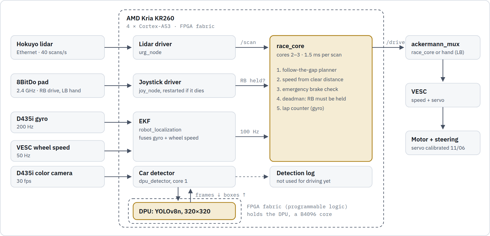
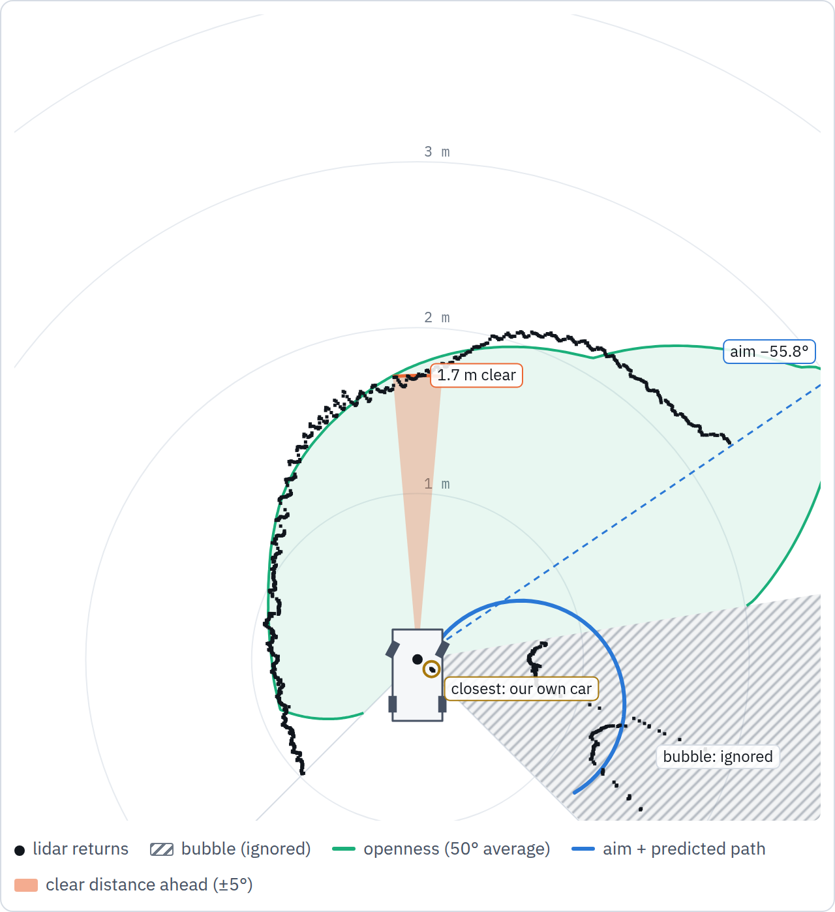
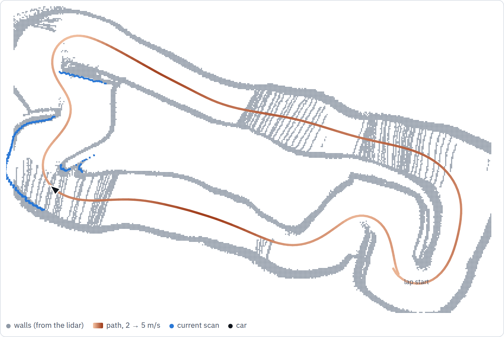
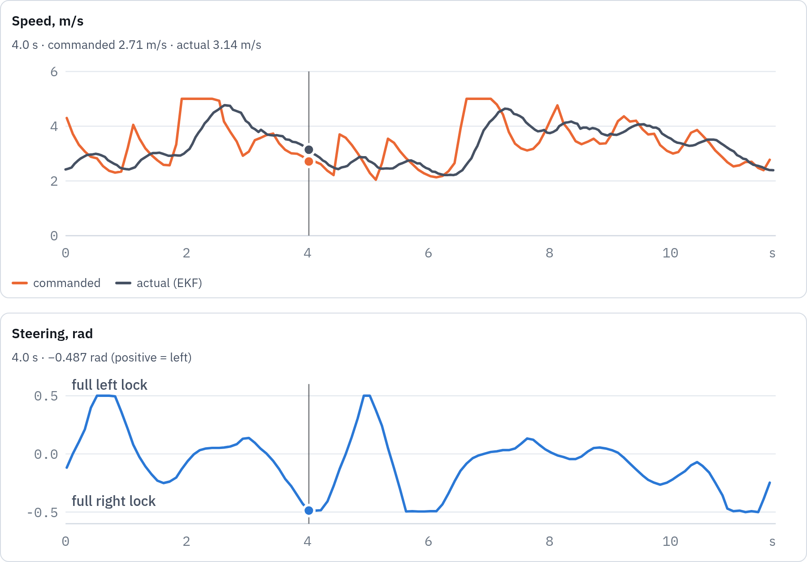
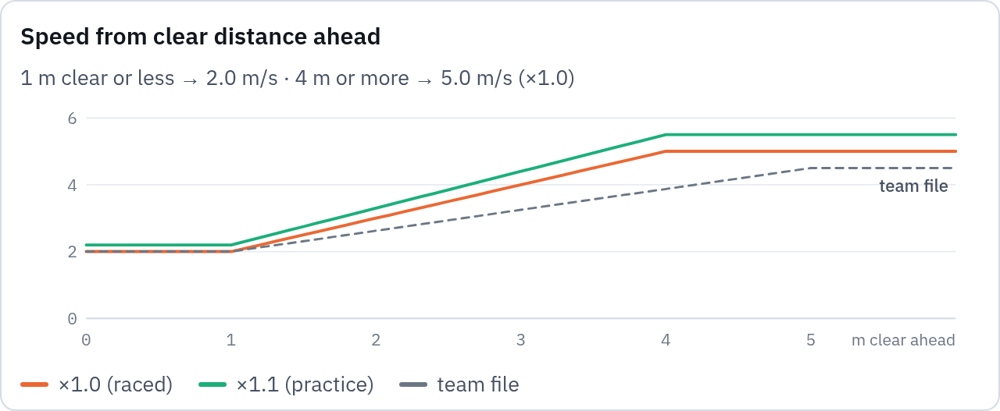
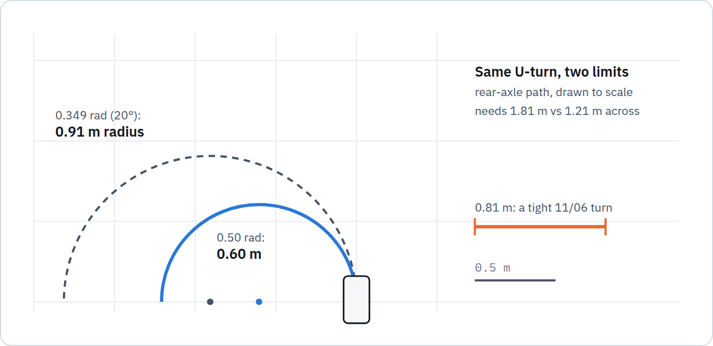
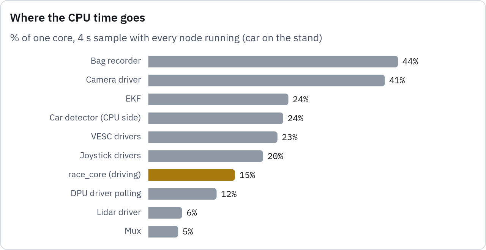

# Blaze Racer

**1st place of 7 cars at the F1Tenth race on 7 November 2026.** This is UCF airacer's car, and an AMD Kria KR260 drives it.

Every 25 ms the lidar hands the KR260 1,081 distance readings. About 1.5 ms later the car has:

- picked the most open direction;
- steered halfway toward it;
- set its speed from how much room is straight ahead.

There is no map and no planned line: the car decides each scan on its own. This README walks through that loop on a real lap from race-day practice on the race track.

| **1st** | **1.5 ms** | **40 scans/s** |
|---|---|---|
| place of 7 cars on race day, 7 Nov 2026 | to decide per scan (median; 1.8 ms p99) | 1,081 lidar beams over 270° in each |
| **±0.50 rad** | **2–5 m/s** | **0** |
| steering limit (28.6°) | speed range at ×1.0 | emergency brakes in 13 race-day practice laps |

An interactive version is in [`docs/inside-blaze-racer.html`](docs/inside-blaze-racer.html). Download it and open it in a browser to step through the planner on any frame, play the lap, or hover the charts.

**Contents:** [One-minute version](#explaining-it-in-one-minute) · [The car](#1-whats-on-the-car) · [How it sees](#2-how-it-sees-the-track) · [How it drives a lap](#3-how-it-drives-a-lap) · [Safety](#4-what-keeps-it-safe) · [Where the KR260 fits](#5-where-the-kr260-fits) · [How we tuned it](#6-how-we-tuned-it) · [Race day](#7-race-day) · [Glossary](#glossary) · [Repository layout](#repository-layout)

## Explaining it in one minute

> "Our car is reactive. A Hokuyo lidar measures 1,081 distances across the front 270° of the car, 40 times a second. For each scan, our planner on the KR260 finds the most open 50° slice of track and steers half the angle toward it. It picks its speed from the clear distance straight ahead: 2 m/s with 1 m of room, rising to 5 m/s with 4 m or more. That takes about 1.5 ms.
>
> Every scan, an emergency brake checks the path the car is about to drive. It stops the car if it would hit something within 0.12 s. The planner is our team's follow-the-gap, ported line by line to C++ and checked against the original on 5,000 recorded scans.
>
> The KR260's FPGA runs a YOLO car detector on the camera at 30 frames per second, on hardware the driving loop doesn't use. So far the detector only logs other cars; using it to follow and pass is the next step."

> [!TIP]
> People often get two things wrong, so say them precisely:
> - The FPGA does not drive the car; the Arm cores do.
> - The car does not use a map or a racing line in the race; it reacts to each scan.

## 1. What's on the car

| Part | Job | Connection |
|---|---|---|
| **Hokuyo UST-10LX lidar** | Measures the distance to the walls: 1,081 beams 0.25° apart across 270°, 40 scans a second, rated to 10 m. Mounted 0.27 m ahead of the rear axle. | Ethernet, its own port |
| **Intel RealSense D435i** | Color camera at 30 fps for the car detector; gyro at 200 Hz for heading. | USB 3 |
| **VESC motor controller** | Holds the commanded speed, moves the steering servo, reports wheel speed at 50 Hz. | USB serial |
| **AMD Kria KR260** | The computer: 4 Arm Cortex-A53 cores at 1.33 GHz, 4 GB RAM, and FPGA fabric that holds a DPU (a neural-network engine). | – |
| **8BitDo pad, 2.4 GHz dongle** | Hold <kbd>RB</kbd> to let the car drive itself, hold <kbd>LB</kbd> to drive by hand, let go to stop. | USB |

<picture>
  <source media="(prefers-color-scheme: dark)" srcset="docs/img/pipeline-dark.png">
  <source media="(prefers-color-scheme: light)" srcset="docs/img/pipeline-light.png">
  
</picture>

What feeds what:

- Only the lidar decides where the car goes.
- The gyro and wheel speed go into an EKF. race_core uses its odometry to count laps.
- The camera's detections are logged but don't reach the steering.
- race_core is pinned to cores 2–3 and the detector's CPU work to core 1. The drivers can use any core.

## 2. How it sees the track

Below is one frame of a real lap (race-day practice, ×1.0, clockwise, 4:14 pm). It is 4.0 s into the lap, and the car is turning right at nearly full lock. The car is at the bottom, pointing up, and the rings are 1 m apart.

<picture>
  <source media="(prefers-color-scheme: dark)" srcset="docs/img/scan-dark.png">
  <source media="(prefers-color-scheme: light)" srcset="docs/img/scan-light.png">
  
</picture>

| This frame (4.0 s into an 11.7 s lap) | Value |
|---|---|
| Car speed | 3.10 m/s (EKF: gyro + wheel speed) |
| Closest return | 0.10 m at −124.5°: our own car |
| Bubble (ignored) | −134.8° to −80.8° |
| Most open direction | −55.8°, the centre of the roomiest 50° window |
| Steering | −0.487 rad (−27.9°): half the aim, limited to ±0.50 rad |
| Clear ahead → speed | 1.71 m → 2.71 m/s at ×1.0 |
| Car's recorded command | −27.9° steering, 2.71 m/s: the same |

### The planner, step by step

1. **Read.** 1,081 distances, one every 0.25° across 270°, 40 times a second. Anything farther than 10 m counts as 10 m.
2. **Smooth.** Average each distance with its two neighbours, so one stray reading can't open or close a gap.
3. **Bubble.** Find the closest reading and ignore 175 beams (43.75°) on each side of it.
4. **Gap.** Keep the longest run of beams that isn't ignored.
5. **Aim.** Slide a 200-beam (50°) window across the gap and average the distances in it. Aim at the centre of the window with the most room.
6. **Steer.** Steering angle = half the aim angle, limited to ±0.50 rad (28.6°).
7. **Speed.** Average the distance straight ahead (±5°). 1 m or less gives 2.0 m/s and 4 m or more gives 5.0 m/s, in a straight line between. Then multiply by the speed scale (×1.0 or ×1.1).
8. **Brake check.** Project the car's path for that steering. If a reading in the car's width along it is less than 0.12 s away, command zero speed for 0.4 s.

Steps 1–7 are in [`follow_gap_iv.cpp`](race_ws/src/race_core/src/follow_gap_iv.cpp). The brake check, deadman and lap counter are in [`race_core_node.cpp`](race_ws/src/race_core/src/race_core_node.cpp).

> [!NOTE]
> **What the bubble lands on: our own car.** The lidar sees a small part of our own car, just behind and to the side of the sensor. That is always the closest thing in the scan, so the bubble lands there, not on a wall. It did so in:
> - 91% of scans in race-day practice (−127°, 11 cm);
> - 98% in the 11/06 run 6;
> - 100% in the 11/06 run 5.
>
> In the other scans the closest reading is within 11 cm of the sensor, and no wall gets that close while driving. So in practice step 5 steers the car: it aims at the 50° slice of track with the most room, which tends to point down the track and around corners. That is why it drives smoothly and doesn't flinch at one close reading.
>
> This matters in the 1v1:
> - A car directly ahead shortens the clear distance, so we slow down, to 2.0 m/s at 1 m.
> - A car beside us only makes that side look less open.
> - The emergency brake is the last resort.

The interactive page re-runs this planner in your browser on every frame of the lap and compares the result with what the car commanded: 117 of 117 frames match. The C++ planner on the car was checked the same way against the team's Python original on 5,000 scans, with identical steering ([`ftg_iv_parity.py`](race_ws/src/race_core/tools/ftg_iv_parity.py)).

## 3. How it drives a lap

Speed comes only from the clear distance straight ahead, and steering only from the most open direction. Together they make the car brake for corners on its own. As the wall at the end of a straight comes up, the clear distance shrinks and the speed drops.

<picture>
  <source media="(prefers-color-scheme: dark)" srcset="docs/img/lap-map-dark.png">
  <source media="(prefers-color-scheme: light)" srcset="docs/img/lap-map-light.png">
  
</picture>

This is the race track as the car saw it on this lap, drawn from its own lidar and odometry (about 39 m, clockwise). No map is used while driving; this one is only for us. The arrow is the car at 4.0 s, the frame above, and that scan is drawn in blue.

<picture>
  <source media="(prefers-color-scheme: dark)" srcset="docs/img/lap-trace-dark.png">
  <source media="(prefers-color-scheme: light)" srcset="docs/img/lap-trace-light.png">
  
</picture>

These are speed and steering over the same lap; the cursor marks 4.0 s. The motor needs time: on this lap the command touched 5.0 m/s but the car peaked at 4.8 m/s. It spent 6% of the lap at full steering lock.

The speed rule, with *d* the average clear distance within ±5° of straight ahead:

```
speed = scale × (2.0 + 3.0 × clamp((d − 1.0) / 3.0, 0, 1))   m/s
```

<picture>
  <source media="(prefers-color-scheme: dark)" srcset="docs/img/speed-rule-dark.png">
  <source media="(prefers-color-scheme: light)" srcset="docs/img/speed-rule-light.png">
  
</picture>

This is the race-day speed rule. The team's file reached 4.5 m/s at 5 m; we reach 5.0 m/s at 4 m, so short straights are fast too. We raced at ×1.0; ×1.1 was also clean in practice.

<picture>
  <source media="(prefers-color-scheme: dark)" srcset="docs/img/turning-dark.png">
  <source media="(prefers-color-scheme: light)" srcset="docs/img/turning-light.png">
  
</picture>

This is why the steering limit went from 0.349 to 0.50 rad. With a 0.33 m wheelbase, the tightest circle shrinks from a 0.91 m to a 0.60 m radius (R = wheelbase ÷ tan(steering)). On 11/06 the old limit ran the car into the outside wall in turns 0.58–0.81 m wide. With the new one it ran 14 clean laps counter-clockwise and 13 clockwise, using full lock in the tightest turns.

## 4. What keeps it safe

- **Deadman button.** The car drives itself only while <kbd>RB</kbd> is held. Let go and race_core commands zero speed on the next scan; a joystick message older than 0.3 s counts as let go.
- **Emergency brake.** Every scan, race_core projects the path for the current steering. It looks for readings inside the car's width (0.17 m each side) ahead of the front bumper. If one is less than 0.12 s away at the current speed, it commands zero for 0.4 s. The brake is off below 0.8 m/s. 0.12 s is about 0.6 m at 5 m/s.
- **Watchdogs.** If no lidar scan arrives for 0.15 s, the car stops. The joystick driver runs in a restart loop, because it crashed once when the pad woke up from sleep.
- **Hand control.** Hold <kbd>LB</kbd> to drive by hand at any time; the mux gives the pad priority. Press the pad's Home button before each run, because it sleeps after a few idle minutes.

## 5. Where the KR260 fits

Most of our lap time comes from the planner and its tuning, and that software would run on any of the computers in this field. What the KR260 adds is room. It runs camera perception on separate hardware at full frame rate, while the driving loop stays light and on its own cores. None of the other cars in this race carried a camera, so that capability was ours alone.

| What | Measured on our car | Where it comes from |
|---|---|---|
| **Driving decision** | 1.5 ms median · 1.8 ms p99 · 5.1 ms worst, per 25 ms scan | Software: the C++ planner on cores 2–3. A Jetson could run it too. |
| **Car detector** (YOLOv8n, 320×320) | 5.7 ms on the DPU · ~10 ms per frame overall · 30 fps | KR260 hardware: the DPU is a deep-learning processor built in the FPGA fabric. Its CPU-side work is pinned to core 1. |
| **Whole stack** | ~65% of the 4 cores | Measured with lidar, camera, detector, EKF, joystick and the recorder all running. |
| **Extra sensors** | Camera and gyro (D435i) | The gyro gives the EKF a clean heading (the lap counter counts 360° turns); the camera sees other cars. |
| **Fast, clean laps** | 11.3 s practice laps at ×1.1, 0 emergency brakes | Software and tuning: steering limit 0.50 rad, 2 → 5 m/s speed rule, the team's servo calibration. |

<picture>
  <source media="(prefers-color-scheme: dark)" srcset="docs/img/cpu-dark.png">
  <source media="(prefers-color-scheme: light)" srcset="docs/img/cpu-light.png">
  
</picture>

The chart shows CPU use as % of one core, from a 4 s sample with every node running and the car on the stand. The driving loop (race_core) is one of the smaller consumers. The camera driver and the bag recorder cost the most.

**Not used yet**

- **Detections don't steer or brake.** They are logged with a bearing to each car. Following and passing with them needs testing against a second car.
- **The two Cortex-R5F real-time cores** are idle.
- **Nothing in the FPGA touches the lidar.** The planner takes 1.5 ms on the Arm cores, so it doesn't need to.

**Fair comparison with a Jetson.** On paper a Jetson has faster Arm cores and a GPU that could also run a detector. Our case is not raw speed. It is that perception runs on dedicated hardware with steady timing. It sits next to a driving loop that uses a small slice of the CPU, on the only car in the race with a camera.

## 6. How we tuned it

| When | What |
|---|---|
| 10/26 | **First track session.** Laps ran wide on right turns because the servo horn was off-centre. It was re-seated on 10/29. |
| 11/06 evening | **Moved to the team's iv2026 code.** race_core runs the team's follow-the-gap, ported to C++ and checked against the Python original on 5,000 recorded scans (identical steering). |
| 11/06 · run 1 | **Team settings as they were (0.349 rad).** 4.6 s laps on the small test track, but it touched the walls in the 0.81 m turns. |
| 11/06 · run 3 | **Tried racing-line mode** (map + localization). At speed, position was off by 0.15–0.3 m, more than the 0.28 m it kept from the walls. Dropped for this race. |
| 11/06 · runs 4–5 | **Steering limit 0.50 rad.** 14 clean laps counter-clockwise, 13 clockwise. |
| 11/06 · run 6 | **Top speed 5.0 m/s from 4 m of clear track** (was 4.5 m/s from 5 m). Became the race-day default. |
| 11/07 · runs 7–8 | **Speed ceiling.** ×1.1 clean on the oval; ×1.2 touched walls on a tight figure 8. |
| 11/07 · race track | **Practice:** about 11.75 s a lap at ×1.0 and 11.3 s at ×1.1. 13 laps, 0 emergency brakes. |
| 11/07 · race | **1st place.** The timed trial and the 1v1 heats ran at ×1.0. Best trial lap: 3.34 s on the small trial layout, with 0 emergency brakes. Clean 1v1 laps: 10.5–12.0 s on the race track. |

Every run is in [`logs/RUNS.md`](logs/RUNS.md).

## 7. Race day

| Race | Setting | Result |
|---|---|---|
| **Timed trial** (alone on track) | ×1.0 · 2.0–5.0 m/s | 8 laps of the small trial layout in 31.8 s, best 3.34 s, 0 emergency brakes |
| **1v1 heats** (60 s, side-by-side start) | ×1.0 · 2.0–5.0 m/s | Clean laps of 10.5–12.0 s on the 39 m race track |
| **Final standing** | | **1st place** of 7 cars |

```bash
# on the KR260, in ~/2x1_w
./race.sh up det        # drivers, EKF, joystick watchdog, planner (×1.0), car detector
./race.sh check         # lidar ~40, odometry ~50, pad ~17-20, gyro ~200, EKF ~100, camera ~30 Hz
./race.sh rscale 1.1    # faster, clean in practice (takes effect while driving)
./race.sh rscale 1.0    # race setting (the default)
./race.sh down          # stop everything before powering off
```

`race.sh up` starts everything in a tmux session called `car`, and `./race.sh` with no arguments lists every command. The drivers, the servo calibration and the original follow-the-gap come from the team's blaze_racer repo (branch `iv2026`, in `~/blaze_racer` on the car). [`TEST_DAY.md`](TEST_DAY.md) is the step-by-step guide for a track session.

## Glossary

| Term | Meaning |
|---|---|
| Lidar scan | One sweep of the laser: 1,081 distances, each tagged with its angle. |
| Follow-the-gap | A reactive planner: steer toward the most open part of the scan. No map, no memory between scans. |
| Bubble | Beams around the closest reading that the planner ignores, meant to keep it away from obstacles. |
| Bearing / aim | The angle of the chosen direction: 0 = straight ahead, positive = left. |
| Speed scale (×1.0, ×1.1) | One number that multiplies every speed the planner picks, changeable while driving. |
| TTC | Time to collision: distance along the path divided by speed. |
| EKF | Extended Kalman filter. Blends the gyro and wheel speed into position, heading and speed. |
| DPU | AMD's deep-learning processor, built in the FPGA fabric. Runs our YOLO detector. |
| FPGA fabric | Programmable logic on the KR260's chip, configured here as the DPU. |
| race_core | Our C++ driving program: planner, speed rule, emergency brake, deadman, lap counter. |
| Deadman | A button that must be held for the car to move (RB). |
| ROS 2 topic | A named data stream between programs, such as `/scan` or `/drive`. |

## Repository layout

| Path | What's there |
|---|---|
| [`race.sh`](race.sh) | One entry point for the car: bring-up, checks, live tuning, recording, shutdown |
| [`race_ws/src/race_core`](race_ws/src/race_core) | The C++ ROS 2 driving node: follow-the-gap (iv2026 port), speed rule, emergency brake, deadman, lap counter. It also holds the racing-line mode (particle filter, raceline, overtaking) and a simulator. |
| [`race_ws/src/dpu_detector`](race_ws/src/dpu_detector) | C++ car detector: D435i color frames → YOLOv8n on the DPU → detections |
| [`ml/`](ml), [`models/`](models) | Training and DPU quantization of the YOLOv8n car detector; compiled `.xmodel` files |
| [`setup/`](setup) | KR260 setup: DPU overlay service, 8BitDo udev rule, install scripts |
| [`tools/`](tools) | Bag and log analysis (stints, laps, emergency brakes, wall clearance, where the bubble lands, the explainer's lap data) and the README figure renderer |
| [`maps/`](maps) | Track maps and racing lines from mapping runs |
| [`logs/RUNS.md`](logs/RUNS.md) | The run sheet: every track run with its settings and results |
| [`docs/`](docs) | The interactive explainer page and the README figures |
| [`RACE_PLAN.md`](RACE_PLAN.md), [`WORKFLOW.md`](WORKFLOW.md), [`TEST_DAY.md`](TEST_DAY.md) | The race plan and decision log, the engineering workflow, the track-session runbook |
| [`research/`](research) | Benchmarks behind the plan (DPU, ROS 2 latency, lap-time model) |

---

**Sources**

- The lap is lap 2 of the second practice stint on 11/07 (×1.0, clockwise; bag `1107_211154_rd_prac1`).
- Lap times and emergency brakes come from race_core's log.
- The CPU sample was taken at 4:33 pm with the car on the stand.
- DPU timings come from the detector's log.
- History and race results come from `logs/RUNS.md`.
- `tools/explain_extract.py` extracts the lap data from the bag, and `tools/readme_figures.py` renders the figures from `docs/inside-blaze-racer.html`.
